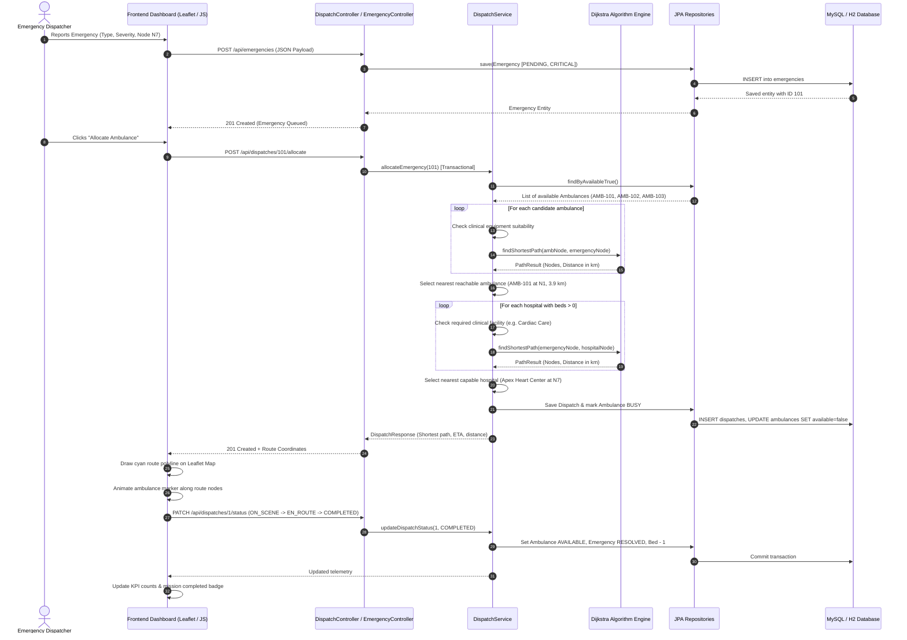
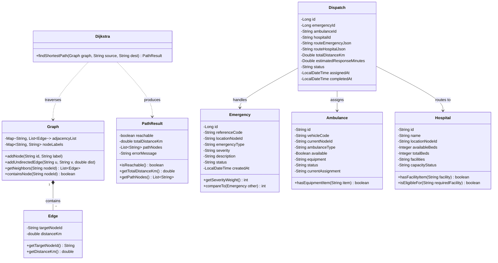
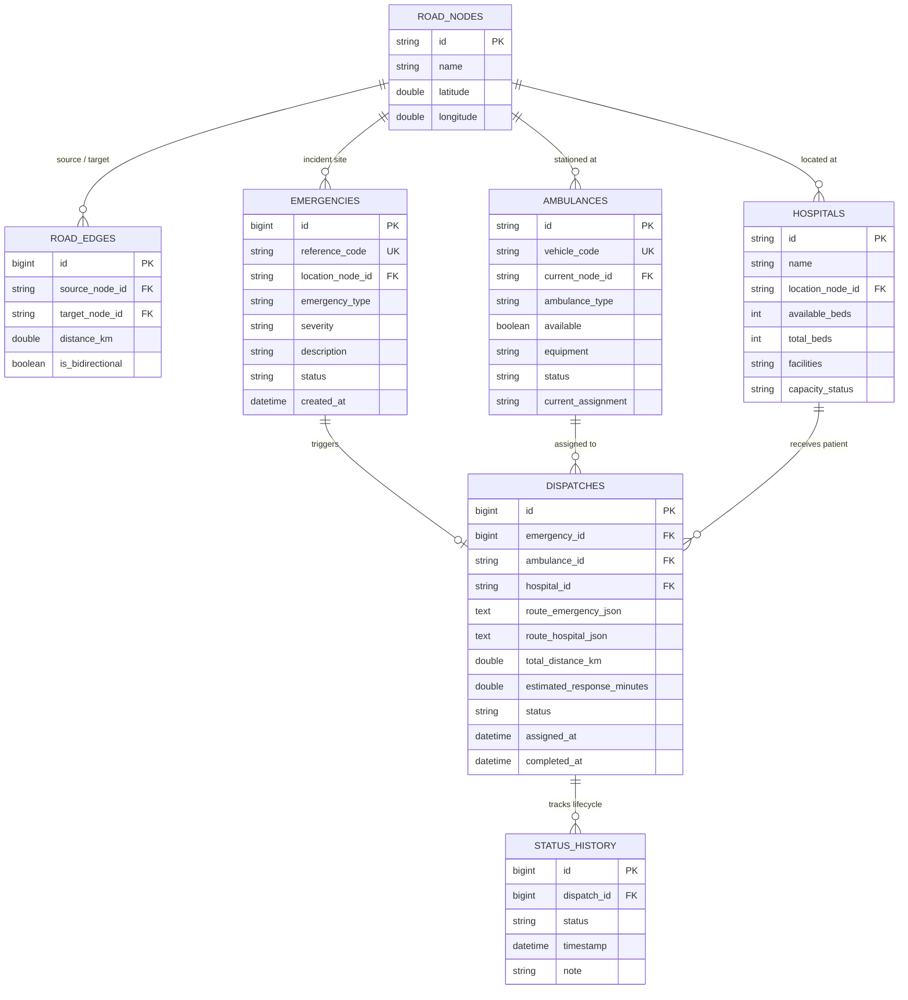

# System Architecture & Technical Specifications
## Smart Ambulance Dispatch & Emergency Management System (ResQ Dispatch)

---

### 1. High-Level System Architecture

ResQ Dispatch is engineered following a clean, enterprise-grade layered architecture:

```mermaid
graph TD
    subgraph ClientLayer["Frontend Client (Web Browser)"]
        UI["Command Center Dashboard (HTML5 / CSS3 / Vanilla JS)"]
        LeafletMap["Interactive Leaflet.js GPS Simulation"]
    end

    subgraph ControllerLayer["Spring Boot REST API Layer"]
        EC["EmergencyController (/api/emergencies)"]
        AC["AmbulanceController (/api/ambulances)"]
        HC["HospitalController (/api/hospitals)"]
        DC["DispatchController (/api/dispatches)"]
        RC["RouteController (/api/routes)"]
        RepC["ReportController (/api/reports)"]
        GEH["GlobalExceptionHandler (@RestControllerAdvice)"]
    end

    subgraph ServiceLayer["Business Logic & Algorithm Layer"]
        ES["EmergencyService (Priority Queue Triage)"]
        DS["DispatchService (Transactional Allocation Engine)"]
        AmbS["AmbulanceService (Fleet & Equipment Matching)"]
        HospS["HospitalService (Facility & Bed Capacity Check)"]
        RS["RouteService (Graph Cache & Query)"]
        RepS["ReportService (Telemetry & KPI Aggregator)"]
        DijkstraEngine["Dijkstra Shortest Path Engine (O((V+E)log V))"]
    end

    subgraph DataAccessLayer["Persistence Layer (Spring Data JPA)"]
        ERepo["EmergencyRepository"]
        ARepo["AmbulanceRepository"]
        HRepo["HospitalRepository"]
        DRepo["DispatchRepository"]
        SHRepo["StatusHistoryRepository"]
        RNRepo["RoadNodeRepository"]
        RERepo["RoadEdgeRepository"]
    end

    subgraph DatabaseLayer["Relational Database"]
        DB[("MySQL 8.x / H2 In-Memory DB")]
    end

    UI -->|REST / JSON (Fetch)| ControllerLayer
    ControllerLayer --> ServiceLayer
    DS --> DijkstraEngine
    RS --> DijkstraEngine
    ServiceLayer --> DataAccessLayer
    DataAccessLayer --> DatabaseLayer
```

---

### 2. End-to-End Workflow Sequence Diagram



---

### 3. UML Class Diagram



---

### 4. Database Entity-Relationship (ER) Diagram



---

### 5. Algorithmic Complexity Analysis

#### Dijkstra's Algorithm:
- **Vertices ($V$):** 18 road intersections (`N1` to `N18`).
- **Edges ($E$):** 28 bidirectional road segments (56 directed edges).
- **Time Complexity:** $\mathcal{O}((V + E) \log V)$
  - Extract-min operation: Each vertex extracted from PriorityQueue at most once $\rightarrow V \log V$.
  - Edge relaxation: Each edge visited once per directed representation and relaxed into heap $\rightarrow E \log V$.
- **Space Complexity:** $\mathcal{O}(V + E)$
  - Adjacency list: $\mathcal{O}(V + E)$
  - Distance map, visited set, predecessor map: $\mathcal{O}(V)$
  - Priority queue: $\mathcal{O}(V)$

#### Priority Queue Emergency Sorting:
- **Time Complexity:**
  - Insertion (`offer`): $\mathcal{O}(\log N)$
  - Extraction (`poll`): $\mathcal{O}(\log N)$
  - Peek highest priority: $\mathcal{O}(1)$
- **Comparator Order:**
  1. Primary: Severity weight (`CRITICAL` = 4, `HIGH` = 3, `MEDIUM` = 2, `LOW` = 1).
  2. Secondary: Creation timestamp (`createdAt` ascending, guaranteeing FIFO fairness for identical severity).
